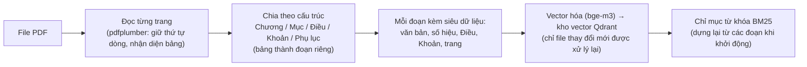
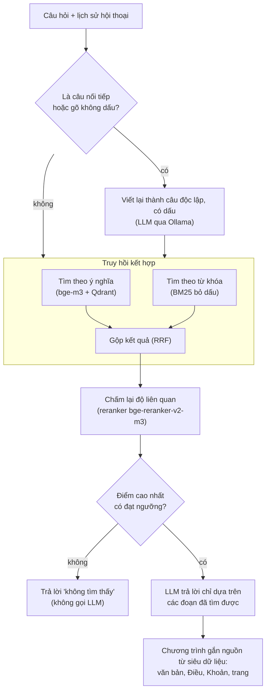

# RAG Chatbot – Hỏi đáp văn bản tiếng Việt, trích dẫn đến từng Điều/Khoản

Chatbot cho phép **đặt câu hỏi bằng ngôn ngữ tự nhiên** trên một bộ tài liệu tiếng Việt (bản demo dùng văn bản pháp luật về lao động và bảo hiểm xã hội) và nhận câu trả lời **kèm nguồn trích dẫn chính xác**: tên văn bản, Điều, Khoản và số trang.

Toàn bộ hệ thống chạy **trên máy của bạn**: tài liệu và câu hỏi không bị gửi lên dịch vụ bên ngoài, không cần API trả phí.

## Demo

<!-- Sau khi quay xong, thay dòng chữ bên dưới bằng:   -->
*(Ảnh demo sẽ được thêm vào đây. Kịch bản gồm ba câu hỏi: câu thường, câu gõ không dấu và câu ngoài phạm vi bị từ chối. Xem [docs/demo.md](docs/demo.md).)*

## Ví dụ

```text
Bạn:     Người lao động làm việc đủ 12 tháng thì được nghỉ hằng năm bao nhiêu ngày?
Chatbot: Người lao động làm việc đủ 12 tháng cho một người sử dụng lao động được nghỉ
         hằng năm 12 ngày làm việc.

         Nguồn:
         - Bộ luật Lao động 2019 (văn bản hợp nhất), Điều 113, Khoản 1–3 (trang 39)
         - Nghị định 145/2020/NĐ-CP, Điều 66, Khoản 1–2 (trang 25)

Bạn:     Thủ tục đăng ký kết hôn cần những giấy tờ gì?
Chatbot: Tôi không tìm thấy thông tin này trong tài liệu.
```

Chatbot chỉ trả lời dựa trên tài liệu được cung cấp. Nếu tài liệu không có thông tin, nó nói thẳng là không tìm thấy thay vì đoán. Đây là kết quả chạy thật; mô hình ngôn ngữ nhỏ vẫn có thể sai, vì vậy hãy luôn kiểm tra điều khoản được trích dẫn (xem [Hạn chế](#hạn-chế-hiện-tại)).

## Tóm tắt kết quả

Mọi số lấy từ file báo cáo trong [evals/reports/](evals/reports/); "chưa đo" nghĩa là chưa có báo cáo, không phải kết quả tốt hay xấu.

| Hạng mục | Kết quả | Báo cáo |
|---|---|---|
| Bộ tài liệu | 8 văn bản pháp luật, 423 trang, 1881 đoạn chia theo Điều/Khoản | `final-corpus-stats.json` |
| Cập nhật chỉ mục khi đổi **một** file | Qdrant 36,9 giây (file nhỏ) và 149,7 giây (file lớn); FAISS phải dựng lại toàn bộ trong 804,5 giây. Dựng lần đầu Qdrant **chậm hơn** 15% (924,0 so với 804,5 giây) | `final-index-timing.json` |
| Qdrant thay FAISS có đổi kết quả truy hồi không | Không: 215/215 câu cho cùng thứ hạng top-5 (dense và hybrid), chênh điểm lớn nhất 4×10⁻⁷ | `final-store-equivalence.json` |
| 20 người dùng đồng thời (RTX 4060 8 GB) | Thông lượng 0,23 → 0,59 yêu cầu/s sau khi sửa nút thắt VRAM, 0,74 với 2 slot; độ trễ p50 84,7 → 34,7 → 25,2 giây | `final-perf-*.json` |
| Độ chính xác câu trả lời, ablation từng cải tiến | **Chưa đo** (bộ câu hỏi nháp chưa được duyệt tay) | — |

Chi tiết và cách đọc từng số ở các mục bên dưới.

## Tính năng

- **Trích dẫn đến từng Điều/Khoản:** nguồn được tạo từ siêu dữ liệu của đoạn văn bản được truy hồi, không để mô hình tự ghi (mô hình nhỏ dễ ghi sai nguồn).
- **Từ chối khi không có thông tin:** câu hỏi ngoài phạm vi tài liệu được từ chối thay vì bịa ra câu trả lời.
- **Hỏi tiếp tự nhiên:** hiểu các câu nối tiếp như "còn trường hợp nghỉ ốm thì sao?" dựa trên cuộc trò chuyện trước đó.
- **Gõ không dấu:** câu hỏi không dấu được viết lại thành câu có dấu trước khi tìm kiếm (còn hạn chế, xem phần đánh giá).
- **Hiểu cấu trúc văn bản pháp luật:** chia theo Chương / Mục / Điều / Khoản / Phụ lục, giữ bảng thành một đoạn riêng.
- **Ba cách dùng:** giao diện web (câu trả lời hiện dần theo thời gian thực), dòng lệnh, hoặc REST API.
- **Chạy local:** mô hình ngôn ngữ chạy trên máy qua Ollama; có thể đóng gói bằng Docker.

## Công nghệ sử dụng

| Nhóm | Công nghệ |
|---|---|
| Ngôn ngữ, framework | Python, LangChain, FastAPI |
| Mô hình ngôn ngữ | Ollama (mặc định `qwen2.5:7b-instruct`) |
| Tìm kiếm | Embedding `BAAI/bge-m3`, Qdrant (hoặc FAISS), BM25 (tự cài, bỏ dấu), reranker `BAAI/bge-reranker-v2-m3` |
| Đọc tài liệu | pdfplumber (văn bản pháp luật, nhận diện bảng), Unstructured (tài liệu thường) |
| Quan sát | OpenTelemetry + Jaeger (tracing), Prometheus (`/metrics`) |
| Triển khai | Docker, Docker Compose, GitHub Actions |
| Chất lượng mã | pytest (hơn 300 bài kiểm thử, không cần tải mô hình), ruff |

## Cách hoạt động

**Khi nạp tài liệu** (chạy một lần, kết quả được lưu trên đĩa):



**Khi trả lời một câu hỏi:**



Một vài điểm đáng chú ý:

- **Chia theo Điều/Khoản thay vì theo độ dài:** mỗi đoạn là một quy định trọn vẹn, và mọi đoạn đều lặp lại tên văn bản, Chương và tiêu đề Điều để các văn bản có Điều trùng số không bị lẫn.
- **Kết hợp hai cách tìm kiếm:** tìm theo ý nghĩa (hiểu câu diễn đạt khác) và tìm theo từ khóa (chính xác với số liệu, thuật ngữ, câu không dấu).
- **Chấm lại bằng một mô hình riêng** để chọn đúng đoạn cần dùng; điểm này cũng dùng làm "cổng" quyết định câu hỏi có nằm trong phạm vi tài liệu hay không. Ngưỡng được chọn trên tập dev, không phải trên tập dùng để báo cáo.
- **Nguồn trích dẫn do chương trình tự lấy** từ dữ liệu của tài liệu, không để mô hình tự ghi.
- **Cập nhật chỉ mục từng phần:** mỗi file PDF có một mã băm riêng (nội dung file, dòng của nó trong `SOURCES.md`, tham số chia đoạn). Khi khởi động chỉ file mới, file đã đổi hoặc file bị xóa mới phải xử lý; các file còn lại giữ nguyên đoạn và vector đã có. Chỉ mục BM25 nhỏ và rẻ nên được dựng lại từ các đoạn ở mỗi lần khởi động thay vì cập nhật từng phần.

## Kết quả đánh giá

Mọi số liệu dưới đây lấy trực tiếp từ các file báo cáo trong [evals/reports/](evals/reports/) (tên bắt đầu bằng `final-`); cột cuối của bảng ghi tên file để đối chiếu.

### Bộ tài liệu

8 văn bản quy phạm pháp luật công khai (không thuộc đối tượng bảo hộ quyền tác giả), tổng **423 trang**, chia thành **1881 đoạn**. Nguồn, số hiệu và ngày hiệu lực của từng văn bản ghi trong [data/SOURCES.md](data/SOURCES.md); file PDF không đưa vào repo.

| Văn bản | Vai trò trong bộ kiểm thử |
|---|---|
| Bộ luật Lao động 2019 (văn bản hợp nhất 18/VBHN-VPQH) | Văn bản dài (220 Điều) đã được hợp nhất các luật sửa đổi |
| Nghị định 145/2020/NĐ-CP | Hướng dẫn Bộ luật Lao động: nhiều Điều trùng chủ đề với Bộ luật |
| Nghị định 12/2022/NĐ-CP và Nghị định 283/2026/NĐ-CP | Cặp văn bản cũ – mới cùng đề tài (283/2026 thay thế 12/2022), dễ truy hồi nhầm |
| Luật Bảo hiểm xã hội 2024, Luật Việc làm 2025, Luật An toàn, vệ sinh lao động 2015, Luật Bảo vệ dữ liệu cá nhân 2025 | Các lĩnh vực lân cận, tạo "nhiễu" cho việc tìm đúng văn bản |

Cả bộ tài liệu chỉ có **một bảng thật** (Luật Việc làm, Điều 53), nên nhóm câu hỏi về bảng rất nhỏ và kết quả của nhóm này gần như không có ý nghĩa thống kê.

### Bộ câu hỏi

Mỗi câu hỏi được soạn nháp bằng mô hình ngôn ngữ chạy local từ một (hoặc hai) đoạn của chính bộ tài liệu, rồi **người duyệt tay từng câu**; chỉ câu đã duyệt (`verified=true`) được dùng để báo cáo.

- Chương trình tự loại các bản nháp có đáp án không nằm nguyên văn trong đoạn gốc, câu hỏi lộ sẵn đáp án, câu trùng nhau, câu nhắc nhầm văn bản khác, và câu mà đáp án cũng nằm ở một văn bản khác (mơ hồ).
- Bằng chứng (`evidence`) do chương trình cắt nguyên văn từ đoạn gốc; đáp án bắt buộc (`must_include`) là các cụm ngắn.
- Các câu **không có đáp án** gồm hai loại: *near_domain* (gần chủ đề nhưng tài liệu không có) và *off_topic* (ngoài chủ đề).
- Chia **dev / test** cân bằng theo từng nhóm câu hỏi, cố định bằng seed; split đã gán không bao giờ đổi. **Ngưỡng từ chối chỉ được chọn trên dev**, sau đó áp dụng nguyên xi cho test.

<!-- dataset:start -->
**Chưa có số liệu:** bộ câu hỏi chưa được duyệt tay xong. Sau khi duyệt (`python -m evals.review --finalize`), chạy lệnh ở mục [Chạy lại đánh giá](#chạy-lại-đánh-giá) để bảng này tự được điền.
<!-- dataset:end -->

### Ablation: từng cải tiến đóng góp bao nhiêu

Cùng mô hình ngôn ngữ (`qwen2.5:7b-instruct`) và cùng bộ tài liệu; mỗi dòng chỉ đổi **một** thứ so với dòng trước. Kết quả trên tập **test**, kèm khoảng tin cậy bootstrap 95%.

<!-- ablation:start -->
**Chưa đo:** cần bộ câu hỏi đã duyệt tay. Chạy `python -m evals.run_ablation` rồi `python -m evals.summarize evals/reports/final-*-test.json --readme README.md` để bảng này được điền từ các file báo cáo.
<!-- ablation:end -->

Các cột: **hit@1** là tỉ lệ câu có đáp án mà đoạn đúng đứng đầu kết quả tìm kiếm; **MRR** là trung bình nghịch đảo thứ hạng của đoạn đúng đầu tiên; **Context precision** là tỉ lệ đoạn đạt ngưỡng thật sự chứa bằng chứng; **Answerable acc.** là tỉ lệ câu có đáp án được trả lời đúng; **Refusal acc.** là tỉ lệ câu không có đáp án được từ chối đúng.

### Mỗi cải tiến nhằm giải quyết điều gì

Mô tả dưới đây là **mục đích thiết kế**; tác dụng thực tế là các số trong bảng ở trên.

1. **Chia theo Điều/Khoản (thay vì cắt theo độ dài):** cắt theo độ dài hay chia đôi một quy định giữa hai đoạn và làm mất tiêu đề Điều; chia theo cấu trúc giữ trọn ý và cho phép trích dẫn đến từng Khoản.
2. **Tìm kiếm kết hợp BM25:** tìm theo ý nghĩa có thể bỏ sót số liệu, thuật ngữ và số hiệu chính xác; BM25 (bỏ dấu) bổ sung đúng điểm yếu đó.
3. **Reranker:** chấm lại từng cặp (câu hỏi, đoạn) chính xác hơn so sánh vector, giúp đoạn đúng lên đầu và cho một điểm số dùng làm cổng từ chối.
4. **Viết lại câu hỏi:** biến câu nối tiếp và câu gõ không dấu thành câu độc lập, có dấu. Cải tiến này có rủi ro: mô hình nhỏ đôi khi viết lại **sai nghĩa** (quan sát thủ công trên vài câu thử, chưa phải số liệu: "thu viec" bị viết thành "thuiec", "thai san" thành "thai sàn", và "lao động nam" thành "lao động nữ"). Vì vậy bảng đánh giá có thêm phần riêng cho nhóm câu không dấu.

### Giới hạn của phần đánh giá

- Bộ câu hỏi do mô hình soạn nháp nên thiên về những gì mô hình soạn được; việc duyệt tay giảm nhưng không loại bỏ thiên lệch này.
- Đáp án được chấm bằng cụm từ khóa bắt buộc: câu trả lời đúng nhưng diễn đạt khác từ khóa có thể bị chấm sai.
- Chấm tính trung thực (faithfulness) bằng mô hình ngôn ngữ chỉ đáng tin sau khi đã đo độ đồng thuận với người chấm (`python -m evals.judge_check`).
- Số câu mỗi nhóm nhỏ nên khoảng tin cậy khá rộng; hãy đọc khoảng tin cậy thay vì chỉ đọc con số trung bình.
- Chưa lọc theo hiệu lực: bộ tài liệu có cả Nghị định 12/2022 (đã bị thay thế) và Nghị định 283/2026; chatbot hiện có thể trích dẫn cả hai.

## Cập nhật chỉ mục từng phần

Chỉ mục vector nằm trong Qdrant. Mỗi đoạn tài liệu là một bản ghi có đầy đủ siêu dữ liệu (văn bản, số hiệu, Điều, Khoản, trang, mã băm nội dung), nên có thể thêm, sửa hoặc xóa đoạn của **một** file mà không đụng tới các file khác, và có thể lọc truy vấn theo từng văn bản. Với FAISS, đổi một file là phải dựng lại toàn bộ.

<!-- indextiming:start -->
| Thao tác | FAISS | Qdrant |
|---|---|---|
| Dựng lần đầu | 804.5 giây | 924.0 giây |
| Khởi động lại khi không có gì đổi | 0.01 giây | 0.02 giây |
| Sửa 1 file nhỏ (`91_2025_QH15_m_625628.pdf`, xử lý lại 76/1881 đoạn) | 804.5 giây (dựng lại toàn bộ) | 36.9 giây |
| Sửa 1 file lớn (`18_VBHN-VPQH_m_695336.pdf`, xử lý lại 307/1881 đoạn) | 804.5 giây (dựng lại toàn bộ) | 149.7 giây |
| Xóa 1 file (`91_2025_QH15_m_625628.pdf`) | 804.5 giây (dựng lại toàn bộ) | 0.34 giây |

Đo trên 8 văn bản, 1881 đoạn, embedding `BAAI/bge-m3` chạy trên CPU (16 luồng); báo cáo: `final-index-timing.json`.
<!-- indextiming:end -->

### Qdrant cho kết quả giống FAISS

Hai kho vector được so trực tiếp trên cùng câu hỏi và cùng các đoạn: nếu chúng trả về cùng các đoạn theo cùng thứ tự thì thay kho vector không làm đổi chất lượng truy hồi. Đây là phép kiểm tra chặt hơn so sánh độ chính xác, và không cần nhãn đúng/sai. Điều kiện: vector phải được chuẩn hóa (cấu hình mặc định đã bật `normalize_embeddings`), khi đó điểm cosine của Qdrant và tích vô hướng của FAISS cùng thang điểm nên ngưỡng từ chối không phải chỉnh lại.

<!-- equivalence:start -->
| Chế độ truy hồi | Số câu | Cùng thứ tự top-5 | Cùng tập top-5 | Cùng đoạn đứng đầu | Chênh điểm lớn nhất |
|---|---|---|---|---|---|
| dense | 215 | 100.0% | 100.0% | 100.0% | 4e-07 |
| hybrid | 215 | 100.0% | 100.0% | 100.0% | 4.2e-07 |

So trên cùng bộ câu hỏi (`draft-001.jsonl`) và cùng các đoạn tài liệu; báo cáo: `final-store-equivalence.json`.
<!-- equivalence:end -->

## Hiệu năng khi nhiều người dùng

Đo bằng [evals/perf/load_test.py](evals/perf/load_test.py): N người dùng hỏi liên tục (không nghỉ giữa các câu) qua `/chat/stream`, cùng một dãy câu hỏi cố định theo seed cho mọi cấu hình ([questions.jsonl](evals/perf/questions.jsonl): 40 câu lấy mẫu từ bản nháp, gồm câu có đáp án, không dấu, ghép nhiều văn bản và câu bị từ chối; chỉ đo thời gian, không đo độ đúng). VRAM lấy mẫu mỗi giây bằng `nvidia-smi`. **TTFT** là thời gian tới token đầu tiên. Máy đo: RTX 4060 Laptop 8 GB, 16 luồng CPU, torch CUDA 12.8, Ollama 0.40.16, `qwen2.5:7b-instruct` (`num_ctx=4096`), bộ tài liệu 8 văn bản / 1881 đoạn.

<!-- perf:start -->
| Cấu hình | Người dùng | Yêu cầu | Thông lượng (yêu cầu/s) | Độ trễ p50 (s) | p95 (s) | TTFT p50 (s) | Lỗi | VRAM đỉnh (MiB) |
|---|---|---|---|---|---|---|---|---|
| baseline | 1 | 20 | 0.21 | 4.4 | 10.3 | 2.0 | 0 | 7023 |
| baseline | 5 | 20 | 0.27 | 20.4 | 25.6 | 18.9 | 0 | 6957 |
| baseline | 10 | 30 | 0.23 | 37.2 | 59.8 | 34.8 | 0 | 6996 |
| baseline | 20 | 60 | 0.23 | 84.7 | 106.2 | 80.1 | 0 | 7180 |
| serial-1 | 1 | 20 | 0.50 | 2.0 | 3.9 | 1.2 | 0 | 6987 |
| serial-1 | 5 | 20 | 0.62 | 8.1 | 10.5 | 7.6 | 0 | 6839 |
| serial-1 | 10 | 30 | 0.55 | 16.8 | 21.7 | 15.9 | 0 | 6874 |
| serial-1 | 20 | 60 | 0.59 | 34.7 | 38.2 | 33.5 | 0 | 7096 |
| parallel-2 | 1 | 20 | 0.44 | 2.2 | 5.0 | 1.3 | 0 | 7027 |
| parallel-2 | 5 | 20 | 0.56 | 7.5 | 18.3 | 5.7 | 0 | 6917 |
| parallel-2 | 10 | 30 | 0.70 | 12.2 | 17.3 | 11.6 | 0 | 6958 |
| parallel-2 | 20 | 60 | 0.74 | 25.2 | 28.4 | 23.3 | 0 | 7302 |
| parallel-4 | 1 | 20 | 0.38 | 2.6 | 5.4 | 1.4 | 0 | 6789 |
| parallel-4 | 5 | 20 | 0.67 | 5.9 | 10.9 | 2.9 | 0 | 6836 |
| parallel-4 | 10 | 30 | 0.70 | 11.0 | 21.8 | 8.4 | 0 | 6869 |
| parallel-4 | 20 | 60 | 0.77 | 23.6 | 31.8 | 20.8 | 0 | 7098 |
<!-- perf:end -->

Mỗi dòng là **một lần chạy** (chưa lặp lại nhiều lần nên chưa biết độ dao động; chênh lệch nhỏ giữa các dòng, ví dụ `parallel-2` và `parallel-4`, không nên coi là có ý nghĩa). Báo cáo: `evals/reports/final-perf-*.json`.

- `baseline`: mã trước khi sửa (một khóa toàn cục), `OLLAMA_NUM_PARALLEL=1`, embedding và reranker đều chạy GPU.
- `serial-1`: mã mới, 1 slot, embedding chuyển sang CPU (`RAG_EMBEDDING_DEVICE=cpu`).
- `parallel-2`, `parallel-4`: mã mới, `RAG_MAX_CONCURRENT_REQUESTS` và `OLLAMA_NUM_PARALLEL` cùng bằng 2 hoặc 4.

### Điều đo được

1. **Nút thắt đầu tiên là VRAM, không phải khóa.** Ngay sau khi khởi động (embedding fp32 và reranker đã nạp, Ollama chưa nạp mô hình), `nvidia-smi` báo khoảng 3,9 GB VRAM đã bị chiếm; Ollama chỉ đặt được khoảng một nửa mô hình lên GPU (quan sát thủ công bằng `ollama ps`: `50%/50% CPU/GPU`) và phần còn lại chạy bằng CPU, chậm hơn nhiều. Mức dùng GPU trung bình của `baseline` chỉ 27–38%. Bảng ngay dưới danh sách này so ba cách giải quyết với một người dùng: embedding fp16 chỉ nhường thêm một phần (Ollama vẫn bị đẩy 24% sang CPU); chạy cả hai mô hình tìm kiếm trên CPU làm Ollama chạy 100% GPU nhưng reranker CPU quá chậm; **chỉ embedding trên CPU** (mỗi lượt chỉ embed một câu ngắn) cho kết quả tốt nhất và Ollama chạy 100% GPU. Đây là cấu hình của các dòng `serial-1`, `parallel-*` (đặt `RAG_EMBEDDING_DEVICE=cpu`; mặc định vẫn là `auto`). Chưa kiểm tra chênh lệch điểm cosine giữa embedding CPU và GPU (về nguyên tắc chỉ là sai số số học).
2. **Vẫn tuần tự nhưng thông lượng tăng khoảng 2,3–2,6 lần** (0,21 → 0,50 yêu cầu/s với 1 người dùng, 0,23 → 0,59 với 20) chỉ nhờ sửa VRAM: ở 20 người dùng, độ trễ p50 84,7 → 34,7 giây và p95 106,2 → 38,2 giây (so `baseline` với `serial-1`; hai bên khác nhau cả ở mã lẫn thiết bị embedding nên không tách riêng được phần đóng góp của từng thay đổi).
3. **Cho phép chạy đồng thời mang lại ít hơn kỳ vọng.** Ở 20 người dùng, thông lượng 0,59 (1 slot) → 0,74 (2 slot) → 0,77 (4 slot) yêu cầu/s, tức khoảng +25% và +31%; độ trễ p50 34,7 → 25,2 → 23,6 giây. Một GPU 8 GB chạy mô hình 7B đã gần kín tính toán (mức dùng GPU trung bình 83–88% khi tuần tự), nên chạy chồng chủ yếu lấp các khoảng nghỉ (embedding, rerank, tạo prompt) chứ không nhân đôi tốc độ sinh chữ.
4. **Nhiều slot hơn không miễn phí:** với 4 slot, KV cache lớn hơn đẩy khoảng 18% mô hình sang CPU (`ollama ps`), và độ trễ p50 của **một** người dùng tăng từ 2,0 lên 2,6 giây. Với 2 slot, 9% mô hình sang CPU. **Khuyến nghị cho máy 8 GB: 2 slot** (`RAG_MAX_CONCURRENT_REQUESTS=2` và `OLLAMA_NUM_PARALLEL=2`). Mặc định giữ 1 để hành vi không đổi.
5. Không có yêu cầu nào lỗi trong mọi lần đo, và thời gian chờ tối đa (`RAG_QUEUE_TIMEOUT_SECONDS=120` giây) chưa bao giờ bị chạm tới ở 20 người dùng. **Cơ chế từ chối khi quá tải (trả 503 kèm `Retry-After`) mới được kiểm chứng bằng kiểm thử tự động, chưa được đo dưới tải thật.**

Ba cấu hình thiết bị đã thử với **một** người dùng (20 yêu cầu mỗi cấu hình, mã mới, 1 slot):

<!-- perfprobe:start -->
| Cấu hình | Người dùng | Yêu cầu | Thông lượng (yêu cầu/s) | Độ trễ p50 (s) | p95 (s) | TTFT p50 (s) | Lỗi | VRAM đỉnh (MiB) |
|---|---|---|---|---|---|---|---|---|
| embedding GPU fp16, reranker GPU | 1 | 20 | 0.32 | 2.8 | 7.7 | 1.4 | 0 | 6984 |
| embedding CPU, reranker CPU | 1 | 20 | 0.10 | 9.7 | 12.6 | 9.5 | 0 | 5399 |
| embedding CPU, reranker GPU | 1 | 20 | 0.50 | 2.0 | 3.9 | 1.2 | 0 | 6789 |
<!-- perfprobe:end -->

### Cách hoạt động của phần đồng thời

- Mỗi lượt hỏi giành một slot của semaphore (`RAG_MAX_CONCURRENT_REQUESTS`) và giữ nó suốt vòng đời, kể cả khi truyền hiện dần. Hết chờ thì trả `503` + `Retry-After` thay vì để hàng đợi dài vô hạn. Slot được giành *trước* khi bắt đầu truyền để còn trả được mã lỗi.
- Embedding, reranker và Qdrant nhúng không thiết kế để gọi đồng thời từ nhiều thread, nên phần truy hồi (một lượt vài trăm mili-giây) vẫn đi qua một khóa riêng trong `Retriever`; LLM, phần chậm nhất, chạy chồng lên nhau. Khóa này là phần tuần tự còn lại.
- Chưa gom (batch) nhiều câu truy vấn vào một lần chạy model, và chưa thử vLLM (cần thêm thời gian cài đặt và cấu hình; để dành cho hướng phát triển).

### Theo dõi: tracing và metrics

- **`GET /metrics`** (định dạng Prometheus, tắt bằng `RAG_METRICS_ENABLED=false`): thời gian từng bước (`ragbot_stage_seconds{stage=...}`: rewrite, retrieve, dense, bm25, rerank, llm, thời gian chờ khóa), số yêu cầu theo kết quả (`ok`, `refused`, `error`, `busy`), độ trễ từng yêu cầu, thời gian chờ slot, số yêu cầu đang xử lý/đang chờ, số token LLM. Endpoint này không cần khóa API và không chứa nội dung câu hỏi; đừng mở ra Internet.
- **Tracing OpenTelemetry → Jaeger** (tắt mặc định): `docker compose --profile tracing up -d` và đặt `RAG_TRACING_ENABLED=true`, rồi mở http://localhost:16686. Mỗi lượt hỏi là một cây span `ask → rewrite / retrieve (retrieve_lock_wait, dense, bm25, rerank) / llm`, span `llm` kèm số token, tốc độ sinh (token/giây) và TTFT. **Span ghi cả nội dung câu hỏi** (thuộc tính `rag.question`); chỉ bật khi Jaeger nằm trong hệ thống của bạn.

## Bắt đầu nhanh

### Chuẩn bị: bộ văn bản pháp luật

Dự án chạy trên một bộ văn bản pháp luật. **File PDF không nằm trong repo** (`data/corpus/*.pdf` bị bỏ qua khỏi git): hãy đặt các PDF vào `data/corpus/` và ghi nguồn từng file vào [data/SOURCES.md](data/SOURCES.md) (tên file phải khớp từng ký tự). Hướng dẫn chọn đúng loại PDF (phải có lớp chữ, không phải ảnh scan) và danh sách văn bản đang dùng: [data/corpus/README.md](data/corpus/README.md). Thiếu PDF thì ứng dụng dừng ngay với thông báo chỉ tới hướng dẫn này.

### Cách 1: Docker

```bash
docker compose up -d --build
docker compose exec ollama ollama pull qwen2.5:7b-instruct   # chỉ cần lần đầu
```

Compose chạy ba dịch vụ: `ollama` (mô hình ngôn ngữ), `qdrant` (kho vector, dữ liệu nằm trong volume `qdrant`, **không mở cổng ra ngoài**) và `app`. Thư mục `./data` (PDF và `SOURCES.md`) được gắn vào container ở chế độ chỉ đọc.

Mở trình duyệt tại **http://localhost:8000**. Lần đầu app dựng chỉ mục (1881 đoạn, khoảng vài chục phút trên CPU); xong khi `curl localhost:8000/health` báo `"chunks":1881`. Từ lần sau chỉ file thay đổi mới được xử lý lại.

Lưu ý:
- Lần đầu cần mạng để tải mô hình (khoảng 10GB gồm mô hình ngôn ngữ và hai mô hình tìm kiếm).
- Mặc định Ollama trong Docker chạy bằng CPU nên sẽ chậm (một câu trả lời khoảng 20–50 giây). Nếu có GPU NVIDIA và đã cài `nvidia-container-toolkit`, chạy `docker compose -f docker-compose.yml -f docker-compose.gpu.yml up -d`: quan sát thủ công trên máy này, câu trả lời còn khoảng 7 giây khi đã "nóng" (lần đầu lâu hơn do nạp mô hình). Phần embedding và reranker trong container vẫn chạy CPU (image dùng torch bản CPU).
- Nếu cổng 8000 đã bị chiếm, đổi `"8000:8000"` trong `docker-compose.yml` thành cổng khác, ví dụ `"8080:8000"`.

### Cách 2: Chạy trực tiếp trên máy

Cần Python 3.10 và [Ollama](https://ollama.com).

```bash
python -m venv .venv
source .venv/bin/activate
pip install -r requirements.txt

ollama pull qwen2.5:7b-instruct

python -m ragbot.stats                              # kiểm tra bộ tài liệu: số Điều, bảng, file không đọc được
python chatbot.py                                   # dùng qua dòng lệnh
uvicorn ragbot.api:app --host 0.0.0.0 --port 8000   # hoặc mở giao diện web ở http://localhost:8000
```

Lần chạy đầu sẽ tự tải mô hình tìm kiếm từ HuggingFace (khoảng 4GB). Trong dòng lệnh, gõ `reset` để bắt đầu cuộc trò chuyện mới và `exit` để thoát.

Lần đầu dựng chỉ mục cho vài trăm trang mất vài phút (trên CPU: khoảng 0,6 giây mỗi đoạn, tức khoảng 18 phút cho 1881 đoạn). Từ lần sau, thêm, sửa hoặc xóa một PDF chỉ làm xử lý lại đúng file đó (số đo cụ thể ở mục [Cập nhật chỉ mục từng phần](#cập-nhật-chỉ-mục-từng-phần)). PDF phải có lớp chữ; PDF dạng ảnh scan cần OCR (`apt install tesseract-ocr tesseract-ocr-vie`) và hiện chưa được hỗ trợ cho bộ đọc pdfplumber.

Qdrant mặc định chạy **nhúng ngay trong tiến trình** (dữ liệu ở `.index/qdrant`, không cần máy chủ riêng; chỉ một tiến trình mở được cùng lúc). Muốn nối tới một máy chủ Qdrant có sẵn, đặt `RAG_QDRANT_URL=http://localhost:6333`. Muốn chế độ đơn giản nhất, đặt `RAG_VECTOR_STORE=faiss` (nhanh, nhưng đổi một file là dựng lại toàn bộ và lưu bằng `pickle`).

## Dùng qua API

| Đường dẫn | Mô tả |
|---|---|
| `POST /chat` | Trả lời đầy đủ: `{text, refused, question, sources[]}` |
| `POST /chat/stream` | Trả lời hiện dần (Server-Sent Events): `rewrite`, `token`, `done`, `error` |
| `GET /health` | Kiểm tra trạng thái, mô hình đang dùng, số đoạn tài liệu |
| `GET /metrics` | Số liệu Prometheus (xem [Hiệu năng](#hiệu-năng-khi-nhiều-người-dùng)) |

```bash
curl -X POST localhost:8000/chat -H 'content-type: application/json' -d '{
  "question": "còn nghỉ khẩn cấp thì sao?",
  "history": [
    {"role": "user", "content": "Nghỉ ốm cần báo trước mấy giờ?"},
    {"role": "assistant", "content": "Trước 09:00."}
  ]
}'
```

- Mỗi nguồn trong `sources[]` có `file`, `page`, `section`, `score`. Với văn bản pháp luật có thêm `title`, `dieu`, `khoan`, `phu_luc`, `kind` (`text` | `table` | `preamble`) và `citation` (chuỗi trích dẫn đầy đủ, ví dụ "Bộ luật Lao động 2019 (văn bản hợp nhất), Điều 113, Khoản 1–3 (trang 39)").
- Phía người dùng giữ lịch sử và gửi lại mỗi lần; máy chủ không lưu phiên.
- Giới hạn: câu hỏi tối đa 1000 ký tự, lịch sử tối đa 40 tin nhắn.
- Đặt biến `RAG_API_KEY` để yêu cầu header `X-API-Key` cho `/chat` và `/chat/stream`.
- Số lượt hỏi xử lý đồng thời do `RAG_MAX_CONCURRENT_REQUESTS` quyết định (mặc định 1 = lần lượt); quá tải thì trả `503` kèm `Retry-After`. Số đo ở mục [Hiệu năng](#hiệu-năng-khi-nhiều-người-dùng).

## Cấu hình

Mọi tham số đều có giá trị mặc định. Muốn đổi, sao chép `.env.example` thành `.env` rồi sửa, ví dụ:

```bash
RAG_LLM_MODEL=llama3.2:3b     # dùng mô hình nhẹ hơn
RAG_RERANK_MODEL=             # tắt mô hình chấm lại để tiết kiệm bộ nhớ
RAG_API_KEY=mat-khau-cua-ban  # bật khóa API
```

Các tham số về dữ liệu: `RAG_DOCS_DIR` (thư mục PDF, mặc định `data/corpus`), `RAG_PDF_LOADER` (`pdfplumber` mặc định, hoặc `unstructured`), `RAG_CHUNKING` (`legal` mặc định, hoặc `section`, `fixed`), `RAG_SOURCES_FILE`, `RAG_VECTOR_STORE` (`qdrant` hoặc `faiss`), `RAG_QDRANT_URL`, `RAG_QDRANT_COLLECTION`. Về hiệu năng và quan sát: `RAG_MAX_CONCURRENT_REQUESTS`, `RAG_QUEUE_TIMEOUT_SECONDS`, `RAG_EMBEDDING_DEVICE` / `RAG_RERANK_DEVICE` (`auto`, `cpu`, `cuda`), `RAG_EMBEDDING_DTYPE`, `RAG_TRACING_ENABLED`, `RAG_OTLP_ENDPOINT`, `RAG_METRICS_ENABLED`. Danh sách đầy đủ có trong [.env.example](.env.example) và [ragbot/config.py](ragbot/config.py).

## Chạy lại đánh giá

Cần Ollama đang chạy, các mô hình đã tải và bộ PDF trong `data/corpus/`. Lệnh dưới đây dùng đúng quy trình: **chọn ngưỡng trên dev rồi mới chạy test**.

```bash
# 1. Thống kê bộ tài liệu
python -m ragbot.stats

# 2. Soạn nháp, duyệt tay, gộp vào bộ chính thức (evals/dataset_legal.jsonl), chia dev/test
python -m evals.draft_questions --out evals/drafts/draft-001.jsonl
python -m evals.review --draft evals/drafts/draft-001.jsonl
python -m evals.review --finalize

# 3. Ablation 5 cấu hình (mỗi cấu hình: dev chọn ngưỡng, test dùng đúng ngưỡng đó)
python -m evals.run_ablation                 # --dry-run để chỉ xem các lệnh sẽ chạy

# 4. Điền bảng kết quả vào README từ các file báo cáo
python -m evals.summarize evals/reports/final-*-test.json --readme README.md

# 5. Kiểm tra độ tin cậy của mô hình chấm trung thực (judge) so với người
python -m evals.judge_check build && python -m evals.judge_check label && python -m evals.judge_check score
```

Chạy một cấu hình riêng lẻ:

```bash
python -m ragbot.evaluate --dataset evals/dataset_legal.jsonl --split dev --mode retrieval \
    --out evals/reports/dev-x.json
python -m ragbot.evaluate --dataset evals/dataset_legal.jsonl --split test --mode full \
    \
    --threshold-from evals/reports/dev-x.json --out evals/reports/final-x-test.json
```

Chỉ các báo cáo có tên `final-*` mới được đưa vào git; báo cáo chạy thử (`draft-*`, `dev-*`) bị bỏ qua.

### Chạy lại các phép đo hiệu năng và chỉ mục

Các phép đo này không cần bộ câu hỏi đã duyệt. Mỗi lệnh ghi một file `final-*` và điền bảng tương ứng vào README.

```bash
python -m evals.bench_index --readme README.md      # dựng/cập nhật chỉ mục, Qdrant so với FAISS (~40 phút trên CPU)
python -m evals.compare_stores --readme README.md   # kết quả truy hồi của hai kho vector có giống nhau không

# Load test: chạy API ở terminal khác (đặt RAG_EMBEDDING_DEVICE=cpu nếu GPU 8 GB), rồi:
python -m evals.perf.load_test --label serial-1 --users 1,5,10,20 --out evals/reports/final-perf-serial-1.json
python -m evals.perf.summarize evals/reports/final-perf-*.json --readme README.md
```

## Cấu trúc thư mục

```text
.
├── chatbot.py              # chạy chatbot trên dòng lệnh
├── ragbot/
│   ├── config.py           # cấu hình (đọc từ .env)
│   ├── pdf_loader.py       # đọc PDF bằng pdfplumber: thứ tự dòng, bảng, bỏ đầu/chân trang
│   ├── ingest.py           # đọc PDF và chọn cách chia tài liệu
│   ├── legal.py            # chia văn bản pháp luật theo Chương/Mục/Điều/Khoản/Phụ lục
│   ├── corpus.py           # đọc data/SOURCES.md (tên, số hiệu văn bản)
│   ├── vectorstore.py      # kho vector Qdrant (cập nhật từng file, lọc theo văn bản)
│   ├── indexing.py         # đồng bộ chỉ mục với thư mục tài liệu (theo mã băm từng file)
│   ├── lexical.py          # tìm kiếm theo từ khóa (BM25, bỏ dấu tiếng Việt)
│   ├── rerank.py           # chấm lại độ liên quan
│   ├── retrieval.py        # kết hợp các cách tìm kiếm
│   ├── pipeline.py         # luồng hỏi đáp: viết lại câu hỏi, gọi mô hình, nguồn trích dẫn
│   ├── evaluate.py         # đánh giá (retrieval, từ chối, trả lời, khoảng tin cậy)
│   ├── stats.py            # thống kê bộ tài liệu sau khi chia
│   ├── telemetry.py        # tracing (OpenTelemetry) và metrics (Prometheus)
│   ├── api.py              # REST API (FastAPI): semaphore, 503 khi quá tải, /metrics
│   ├── static/index.html   # giao diện web
│   └── cli.py              # giao diện dòng lệnh
├── evals/                  # soạn/duyệt câu hỏi, chạy ablation, tổng hợp kết quả
│   └── perf/               # load test nhiều người dùng, bộ câu hỏi, bảng hiệu năng
├── data/                   # SOURCES.md và thư mục corpus/ (PDF không đưa vào repo)
├── docs/                   # hướng dẫn quay demo
├── tests/                  # kiểm thử tự động
├── Dockerfile, docker-compose.yml
└── .github/workflows/      # kiểm tra tự động khi đẩy mã lên GitHub
```

## Kiểm thử

```bash
pip install -r requirements-dev.txt
pytest -q
ruff check . && ruff format --check .
```

Các bài kiểm thử không cần tải mô hình và không cần Ollama.

## Hạn chế hiện tại

- **Mô hình ngôn ngữ nhỏ có thể trả lời sai** dù đã được cung cấp đúng điều khoản (đặc biệt với quy định có lộ trình hoặc phải tính toán). Luôn đối chiếu với điều khoản được trích dẫn.
- **Viết lại câu hỏi không dấu đôi khi làm sai nghĩa** (xem phần đánh giá). Tắt bằng `RAG_REWRITE_QUERIES=false` nếu cần.
- **Chưa đo chất lượng câu trả lời trên bộ tài liệu pháp luật.** Bộ 215 câu hỏi nháp chưa được duyệt tay nên bảng ablation chưa có số. Hệ quả: ngưỡng từ chối mặc định (0,20) được chọn trên bộ 53 câu cũ cho 5 PDF mẫu (đã bỏ khỏi repo) và chưa được hiệu chỉnh lại cho văn bản pháp luật.
- **Chưa phân biệt văn bản còn hiệu lực hay đã hết hiệu lực:** các văn bản cũ và mới cùng đề tài đều có thể được trích dẫn.
- Bảng không có đường kẻ không được nhận diện thành bảng; bảng kéo dài qua nhiều trang bị tách thành nhiều đoạn.
- PDF dạng ảnh scan chưa được hỗ trợ với bộ đọc pdfplumber (cần bản PDF có lớp chữ).
- Chỉ mục BM25 được dựng lại từ các đoạn ở mỗi lần khởi động (không cập nhật từng phần); rẻ với vài nghìn đoạn nhưng sẽ tốn thêm khi bộ tài liệu lớn hơn nhiều.
- Qdrant nhúng chỉ cho một tiến trình mở cùng lúc (không chạy được hai tiến trình cùng thư mục chỉ mục); cần nhiều tiến trình thì dùng Qdrant dạng máy chủ (Docker Compose).
- Chế độ `faiss` vẫn dùng `pickle` và dựng lại toàn bộ khi đổi một file; chỉ nên dùng thư mục chỉ mục do chính ứng dụng tạo ra.
- Cập nhật từng phần theo từng file: sửa một dòng trong file lớn vẫn xử lý lại cả file đó.
- Một GPU 8 GB chạy mô hình 7B chỉ tăng thông lượng khoảng 25–31% khi cho chạy đồng thời (xem mục Hiệu năng); muốn phục vụ nhiều người hơn cần GPU lớn hơn, mô hình nhỏ hơn hoặc một máy chủ suy luận chuyên dụng (vLLM, chưa thử). Phần truy hồi vẫn tuần tự qua một khóa.
- Mọi số hiệu năng là một lần chạy, chưa lặp lại để đo độ dao động.
- Khởi động mất vài chục giây vì phải nạp ba mô hình.
- Chưa có đăng nhập theo từng người dùng; chỉ có một khóa API dùng chung.

## Hướng phát triển

- Thử vLLM / mô hình lượng tử hóa, gom nhiều truy vấn vào một lần chạy embedding/rerank, và lặp lại các lần đo để có khoảng dao động.
- Lọc theo hiệu lực của văn bản và dùng đồng thời câu hỏi gốc với câu đã viết lại khi tìm kiếm.
- Lưu phiên hội thoại phía máy chủ và xác thực theo người dùng.

---

@author: Ngoc Luong <ngocluongg0101@gmail.com>
