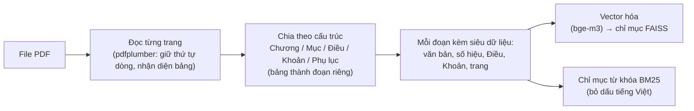
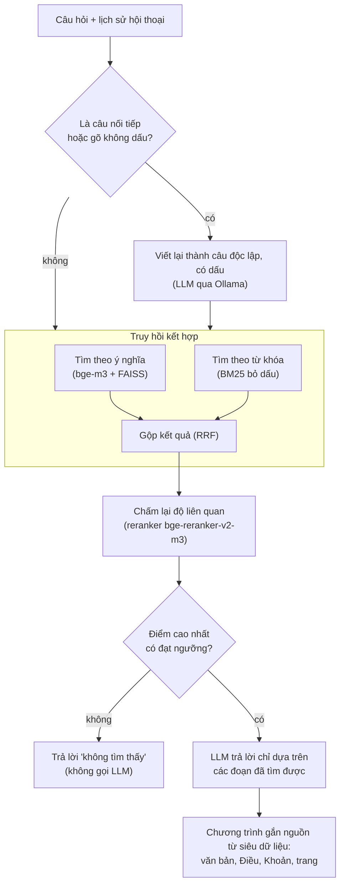

# RAG Chatbot – Hỏi đáp văn bản tiếng Việt, trích dẫn đến từng Điều/Khoản

Chatbot cho phép **đặt câu hỏi bằng ngôn ngữ tự nhiên** trên một bộ tài liệu tiếng Việt (bản demo dùng văn bản pháp luật về lao động và bảo hiểm xã hội) và nhận câu trả lời **kèm nguồn trích dẫn chính xác**: tên văn bản, Điều, Khoản và số trang.

Toàn bộ hệ thống chạy **trên máy của bạn**: tài liệu và câu hỏi không bị gửi lên dịch vụ bên ngoài, không cần API trả phí.

## Demo

<!-- Sau khi quay xong, thay dòng chữ bên dưới bằng:   -->
*(Ảnh demo sẽ được thêm vào đây. Kịch bản gồm ba câu hỏi: câu thường, câu gõ không dấu và câu ngoài phạm vi bị từ chối. Xem [docs/demo.md](docs/demo.md).)*

## Ví dụ

```text
Bạn:     Người lao động làm việc đủ 12 tháng thì được nghỉ hằng năm bao nhiêu ngày?
Chatbot: Người lao động làm việc đủ 12 tháng cho một người sử dụng lao động được nghỉ
         hằng năm 12 ngày làm việc.

         Nguồn:
         - Bộ luật Lao động 2019 (văn bản hợp nhất), Điều 113, Khoản 1–3 (trang 39)
         - Nghị định 145/2020/NĐ-CP, Điều 66, Khoản 1–2 (trang 25)

Bạn:     Thủ tục đăng ký kết hôn cần những giấy tờ gì?
Chatbot: Tôi không tìm thấy thông tin này trong tài liệu.
```

Chatbot chỉ trả lời dựa trên tài liệu được cung cấp. Nếu tài liệu không có thông tin, nó nói thẳng là không tìm thấy thay vì đoán. Đây là kết quả chạy thật; mô hình ngôn ngữ nhỏ vẫn có thể sai, vì vậy hãy luôn kiểm tra điều khoản được trích dẫn (xem [Hạn chế](#hạn-chế-hiện-tại)).

## Tính năng

- **Trích dẫn đến từng Điều/Khoản:** nguồn được tạo từ siêu dữ liệu của đoạn văn bản được truy hồi, không để mô hình tự ghi (mô hình nhỏ dễ ghi sai nguồn).
- **Từ chối khi không có thông tin:** câu hỏi ngoài phạm vi tài liệu được từ chối thay vì bịa ra câu trả lời.
- **Hỏi tiếp tự nhiên:** hiểu các câu nối tiếp như "còn trường hợp nghỉ ốm thì sao?" dựa trên cuộc trò chuyện trước đó.
- **Gõ không dấu:** câu hỏi không dấu được viết lại thành câu có dấu trước khi tìm kiếm (còn hạn chế, xem phần đánh giá).
- **Hiểu cấu trúc văn bản pháp luật:** chia theo Chương / Mục / Điều / Khoản / Phụ lục, giữ bảng thành một đoạn riêng.
- **Ba cách dùng:** giao diện web (câu trả lời hiện dần theo thời gian thực), dòng lệnh, hoặc REST API.
- **Chạy local:** mô hình ngôn ngữ chạy trên máy qua Ollama; có thể đóng gói bằng Docker.

## Công nghệ sử dụng

| Nhóm | Công nghệ |
|---|---|
| Ngôn ngữ, framework | Python, LangChain, FastAPI |
| Mô hình ngôn ngữ | Ollama (mặc định `qwen2.5:7b-instruct`) |
| Tìm kiếm | Embedding `BAAI/bge-m3`, FAISS, BM25 (tự cài, bỏ dấu), reranker `BAAI/bge-reranker-v2-m3` |
| Đọc tài liệu | pdfplumber (văn bản pháp luật, nhận diện bảng), Unstructured (tài liệu thường) |
| Triển khai | Docker, Docker Compose, GitHub Actions |
| Chất lượng mã | pytest (hơn 250 bài kiểm thử, không cần tải mô hình), ruff |

## Cách hoạt động

**Khi nạp tài liệu** (chạy một lần, kết quả được lưu trên đĩa):



**Khi trả lời một câu hỏi:**



Một vài điểm đáng chú ý:

- **Chia theo Điều/Khoản thay vì theo độ dài:** mỗi đoạn là một quy định trọn vẹn, và mọi đoạn đều lặp lại tên văn bản, Chương và tiêu đề Điều để các văn bản có Điều trùng số không bị lẫn.
- **Kết hợp hai cách tìm kiếm:** tìm theo ý nghĩa (hiểu câu diễn đạt khác) và tìm theo từ khóa (chính xác với số liệu, thuật ngữ, câu không dấu).
- **Chấm lại bằng một mô hình riêng** để chọn đúng đoạn cần dùng; điểm này cũng dùng làm "cổng" quyết định câu hỏi có nằm trong phạm vi tài liệu hay không. Ngưỡng được chọn trên tập dev, không phải trên tập dùng để báo cáo.
- **Nguồn trích dẫn do chương trình tự lấy** từ dữ liệu của tài liệu, không để mô hình tự ghi.
- **Lưu sẵn chỉ mục tìm kiếm** trên đĩa; chỉ xây dựng lại khi tài liệu hoặc cấu hình thay đổi.

## Kết quả đánh giá

Mọi số liệu dưới đây lấy trực tiếp từ các file báo cáo trong [evals/reports/](evals/reports/) (tên bắt đầu bằng `final-`); cột cuối của bảng ghi tên file để đối chiếu.

### Bộ tài liệu

8 văn bản quy phạm pháp luật công khai (không thuộc đối tượng bảo hộ quyền tác giả), tổng **423 trang**, chia thành **1881 đoạn**. Nguồn, số hiệu và ngày hiệu lực của từng văn bản ghi trong [data/SOURCES.md](data/SOURCES.md); file PDF không đưa vào repo.

| Văn bản | Vai trò trong bộ kiểm thử |
|---|---|
| Bộ luật Lao động 2019 (văn bản hợp nhất 18/VBHN-VPQH) | Văn bản dài (220 Điều) đã được hợp nhất các luật sửa đổi |
| Nghị định 145/2020/NĐ-CP | Hướng dẫn Bộ luật Lao động: nhiều Điều trùng chủ đề với Bộ luật |
| Nghị định 12/2022/NĐ-CP và Nghị định 283/2026/NĐ-CP | Cặp văn bản cũ – mới cùng đề tài (283/2026 thay thế 12/2022), dễ truy hồi nhầm |
| Luật Bảo hiểm xã hội 2024, Luật Việc làm 2025, Luật An toàn, vệ sinh lao động 2015, Luật Bảo vệ dữ liệu cá nhân 2025 | Các lĩnh vực lân cận, tạo "nhiễu" cho việc tìm đúng văn bản |

Cả bộ tài liệu chỉ có **một bảng thật** (Luật Việc làm, Điều 53), nên nhóm câu hỏi về bảng rất nhỏ và kết quả của nhóm này gần như không có ý nghĩa thống kê.

### Bộ câu hỏi

Mỗi câu hỏi được soạn nháp bằng mô hình ngôn ngữ chạy local từ một (hoặc hai) đoạn của chính bộ tài liệu, rồi **người duyệt tay từng câu**; chỉ câu đã duyệt (`verified=true`) được dùng để báo cáo.

- Chương trình tự loại các bản nháp có đáp án không nằm nguyên văn trong đoạn gốc, câu hỏi lộ sẵn đáp án, câu trùng nhau, câu nhắc nhầm văn bản khác, và câu mà đáp án cũng nằm ở một văn bản khác (mơ hồ).
- Bằng chứng (`evidence`) do chương trình cắt nguyên văn từ đoạn gốc; đáp án bắt buộc (`must_include`) là các cụm ngắn.
- Các câu **không có đáp án** gồm hai loại: *near_domain* (gần chủ đề nhưng tài liệu không có) và *off_topic* (ngoài chủ đề).
- Chia **dev / test** cân bằng theo từng nhóm câu hỏi, cố định bằng seed; split đã gán không bao giờ đổi. **Ngưỡng từ chối chỉ được chọn trên dev**, sau đó áp dụng nguyên xi cho test.

<!-- dataset:start -->
**Chưa có số liệu:** bộ câu hỏi chưa được duyệt tay xong. Sau khi duyệt (`python -m evals.review --finalize`), chạy lệnh ở mục [Chạy lại đánh giá](#chạy-lại-đánh-giá) để bảng này tự được điền.
<!-- dataset:end -->

### Ablation: từng cải tiến đóng góp bao nhiêu

Cùng mô hình ngôn ngữ (`qwen2.5:7b-instruct`) và cùng bộ tài liệu; mỗi dòng chỉ đổi **một** thứ so với dòng trước. Kết quả trên tập **test**, kèm khoảng tin cậy bootstrap 95%.

<!-- ablation:start -->
**Chưa đo:** cần bộ câu hỏi đã duyệt tay. Chạy `python -m evals.run_ablation` rồi `python -m evals.summarize evals/reports/final-*-test.json --readme README.md` để bảng này được điền từ các file báo cáo.
<!-- ablation:end -->

Các cột: **hit@1** là tỉ lệ câu có đáp án mà đoạn đúng đứng đầu kết quả tìm kiếm; **MRR** là trung bình nghịch đảo thứ hạng của đoạn đúng đầu tiên; **Context precision** là tỉ lệ đoạn đạt ngưỡng thật sự chứa bằng chứng; **Answerable acc.** là tỉ lệ câu có đáp án được trả lời đúng; **Refusal acc.** là tỉ lệ câu không có đáp án được từ chối đúng.

### Mỗi cải tiến nhằm giải quyết điều gì

Mô tả dưới đây là **mục đích thiết kế**; tác dụng thực tế là các số trong bảng ở trên.

1. **Chia theo Điều/Khoản (thay vì cắt theo độ dài):** cắt theo độ dài hay chia đôi một quy định giữa hai đoạn và làm mất tiêu đề Điều; chia theo cấu trúc giữ trọn ý và cho phép trích dẫn đến từng Khoản.
2. **Tìm kiếm kết hợp BM25:** tìm theo ý nghĩa có thể bỏ sót số liệu, thuật ngữ và số hiệu chính xác; BM25 (bỏ dấu) bổ sung đúng điểm yếu đó.
3. **Reranker:** chấm lại từng cặp (câu hỏi, đoạn) chính xác hơn so sánh vector, giúp đoạn đúng lên đầu và cho một điểm số dùng làm cổng từ chối.
4. **Viết lại câu hỏi:** biến câu nối tiếp và câu gõ không dấu thành câu độc lập, có dấu. Cải tiến này có rủi ro: mô hình nhỏ đôi khi viết lại **sai nghĩa** (quan sát thủ công trên vài câu thử, chưa phải số liệu: "thu viec" bị viết thành "thuiec", "thai san" thành "thai sàn", và "lao động nam" thành "lao động nữ"). Vì vậy bảng đánh giá có thêm phần riêng cho nhóm câu không dấu.

### Giới hạn của phần đánh giá

- Bộ câu hỏi do mô hình soạn nháp nên thiên về những gì mô hình soạn được; việc duyệt tay giảm nhưng không loại bỏ thiên lệch này.
- Đáp án được chấm bằng cụm từ khóa bắt buộc: câu trả lời đúng nhưng diễn đạt khác từ khóa có thể bị chấm sai.
- Chấm tính trung thực (faithfulness) bằng mô hình ngôn ngữ chỉ đáng tin sau khi đã đo độ đồng thuận với người chấm (`python -m evals.judge_check`).
- Số câu mỗi nhóm nhỏ nên khoảng tin cậy khá rộng; hãy đọc khoảng tin cậy thay vì chỉ đọc con số trung bình.
- Chưa lọc theo hiệu lực: bộ tài liệu có cả Nghị định 12/2022 (đã bị thay thế) và Nghị định 283/2026; chatbot hiện có thể trích dẫn cả hai.

## Bắt đầu nhanh

### Cách 1: Docker

```bash
docker compose up -d --build
docker compose exec ollama ollama pull qwen2.5:7b-instruct   # chỉ cần lần đầu
```

Mở trình duyệt tại **http://localhost:8000**.

Lưu ý:
- Lần đầu cần mạng để tải mô hình (khoảng 10GB gồm mô hình ngôn ngữ và hai mô hình tìm kiếm).
- Mặc định chạy bằng CPU nên sẽ chậm. Nếu có GPU NVIDIA, bỏ dấu `#` ở khối `deploy` trong `docker-compose.yml`.
- Nếu cổng 8000 đã bị chiếm, đổi `"8000:8000"` trong `docker-compose.yml` thành cổng khác, ví dụ `"8080:8000"`.
- Cấu hình mặc định dùng bộ tài liệu mẫu nhỏ trong `papers/`. Muốn dùng bộ văn bản pháp luật, tạo file `docker-compose.override.yml` cạnh `docker-compose.yml`:

```yaml
services:
  app:
    environment:
      RAG_DOCS_DIR: /app/data/corpus
      RAG_PDF_LOADER: pdfplumber
      RAG_CHUNKING: legal
      RAG_INDEX_DIR: /data/index-legal   # tách khỏi chỉ mục của bộ papers/
    volumes:
      - ./data:/app/data:ro
```

### Cách 2: Chạy trực tiếp trên máy

Cần Python 3.10 và [Ollama](https://ollama.com).

```bash
python -m venv .venv
source .venv/bin/activate
pip install -r requirements.txt

ollama pull qwen2.5:7b-instruct

python chatbot.py                                   # dùng qua dòng lệnh
uvicorn ragbot.api:app --host 0.0.0.0 --port 8000   # hoặc mở giao diện web ở http://localhost:8000
```

Lần chạy đầu sẽ tự tải mô hình tìm kiếm từ HuggingFace (khoảng 4GB). Trong dòng lệnh, gõ `reset` để bắt đầu cuộc trò chuyện mới và `exit` để thoát.

### Dùng bộ văn bản pháp luật

Đặt các file PDF vào `data/corpus/` và ghi nguồn vào [data/SOURCES.md](data/SOURCES.md) (hướng dẫn chi tiết, cách chọn đúng loại PDF: [data/corpus/README.md](data/corpus/README.md)), rồi:

```bash
export RAG_DOCS_DIR=data/corpus RAG_PDF_LOADER=pdfplumber RAG_CHUNKING=legal
export RAG_INDEX_DIR=.index-legal          # tách khỏi chỉ mục của bộ papers/ để khỏi bị dựng lại khi đổi qua lại
python -m ragbot.stats                     # kiểm tra: số Điều, bảng, file không đọc được
python chatbot.py
```

Lần đầu dựng chỉ mục cho vài trăm trang mất vài phút (trên CPU: khoảng 0,6 giây mỗi đoạn, tức khoảng 18 phút cho 1881 đoạn). PDF phải có lớp chữ; PDF dạng ảnh scan cần OCR (`apt install tesseract-ocr tesseract-ocr-vie`) và hiện chưa được hỗ trợ cho bộ đọc pdfplumber.

## Dùng qua API

| Đường dẫn | Mô tả |
|---|---|
| `POST /chat` | Trả lời đầy đủ: `{text, refused, question, sources[]}` |
| `POST /chat/stream` | Trả lời hiện dần (Server-Sent Events): `rewrite`, `token`, `done`, `error` |
| `GET /health` | Kiểm tra trạng thái, mô hình đang dùng, số đoạn tài liệu |

```bash
curl -X POST localhost:8000/chat -H 'content-type: application/json' -d '{
  "question": "còn nghỉ khẩn cấp thì sao?",
  "history": [
    {"role": "user", "content": "Nghỉ ốm cần báo trước mấy giờ?"},
    {"role": "assistant", "content": "Trước 09:00."}
  ]
}'
```

- Mỗi nguồn trong `sources[]` có `file`, `page`, `section`, `score`. Với văn bản pháp luật có thêm `title`, `dieu`, `khoan`, `phu_luc`, `kind` (`text` | `table` | `preamble`) và `citation` (chuỗi trích dẫn đầy đủ, ví dụ "Bộ luật Lao động 2019 (văn bản hợp nhất), Điều 113, Khoản 1–3 (trang 39)").
- Phía người dùng giữ lịch sử và gửi lại mỗi lần; máy chủ không lưu phiên.
- Giới hạn: câu hỏi tối đa 1000 ký tự, lịch sử tối đa 40 tin nhắn.
- Đặt biến `RAG_API_KEY` để yêu cầu header `X-API-Key` cho `/chat` và `/chat/stream`.
- Các lượt hỏi được xử lý lần lượt (xếp hàng), phù hợp một nhóm nhỏ dùng nội bộ.

## Cấu hình

Mọi tham số đều có giá trị mặc định. Muốn đổi, sao chép `.env.example` thành `.env` rồi sửa, ví dụ:

```bash
RAG_LLM_MODEL=llama3.2:3b     # dùng mô hình nhẹ hơn
RAG_RERANK_MODEL=             # tắt mô hình chấm lại để tiết kiệm bộ nhớ
RAG_API_KEY=mat-khau-cua-ban  # bật khóa API
```

Các tham số về dữ liệu: `RAG_DOCS_DIR` (thư mục PDF; tên cũ `RAG_PAPERS_DIR` vẫn dùng được), `RAG_PDF_LOADER` (`unstructured` hoặc `pdfplumber`), `RAG_CHUNKING` (`fixed`, `section` hoặc `legal`), `RAG_SOURCES_FILE`. Danh sách đầy đủ có trong [.env.example](.env.example) và [ragbot/config.py](ragbot/config.py).

## Chạy lại đánh giá

Cần Ollama đang chạy, các mô hình đã tải và bộ PDF trong `data/corpus/`. Lệnh dưới đây dùng đúng quy trình: **chọn ngưỡng trên dev rồi mới chạy test**.

```bash
# 1. Thống kê bộ tài liệu
python -m ragbot.stats --set docs_dir=data/corpus --set pdf_loader=pdfplumber --set chunking=legal

# 2. Soạn nháp, duyệt tay, gộp vào bộ chính thức (evals/dataset_legal.jsonl), chia dev/test
python -m evals.draft_questions --out evals/drafts/draft-001.jsonl
python -m evals.review --draft evals/drafts/draft-001.jsonl
python -m evals.review --finalize

# 3. Ablation 5 cấu hình (mỗi cấu hình: dev chọn ngưỡng, test dùng đúng ngưỡng đó)
python -m evals.run_ablation                 # --dry-run để chỉ xem các lệnh sẽ chạy

# 4. Điền bảng kết quả vào README từ các file báo cáo
python -m evals.summarize evals/reports/final-*-test.json --readme README.md

# 5. Kiểm tra độ tin cậy của mô hình chấm trung thực (judge) so với người
python -m evals.judge_check build && python -m evals.judge_check label && python -m evals.judge_check score
```

Chạy một cấu hình riêng lẻ:

```bash
python -m ragbot.evaluate --dataset evals/dataset_legal.jsonl --split dev --mode retrieval \
    --set docs_dir=data/corpus --set pdf_loader=pdfplumber --set chunking=legal --out evals/reports/dev-x.json
python -m ragbot.evaluate --dataset evals/dataset_legal.jsonl --split test --mode full \
    --set docs_dir=data/corpus --set pdf_loader=pdfplumber --set chunking=legal \
    --threshold-from evals/reports/dev-x.json --out evals/reports/final-x-test.json
```

Chỉ các báo cáo có tên `final-*` mới được đưa vào git; báo cáo chạy thử (`draft-*`, `dev-*`) bị bỏ qua.

## Cấu trúc thư mục

```text
.
├── chatbot.py              # chạy chatbot trên dòng lệnh
├── ragbot/
│   ├── config.py           # cấu hình (đọc từ .env)
│   ├── pdf_loader.py       # đọc PDF bằng pdfplumber: thứ tự dòng, bảng, bỏ đầu/chân trang
│   ├── ingest.py           # đọc PDF và chọn cách chia tài liệu
│   ├── legal.py            # chia văn bản pháp luật theo Chương/Mục/Điều/Khoản/Phụ lục
│   ├── corpus.py           # đọc data/SOURCES.md (tên, số hiệu văn bản)
│   ├── indexing.py         # xây dựng và lưu sẵn chỉ mục tìm kiếm
│   ├── lexical.py          # tìm kiếm theo từ khóa (BM25, bỏ dấu tiếng Việt)
│   ├── rerank.py           # chấm lại độ liên quan
│   ├── retrieval.py        # kết hợp các cách tìm kiếm
│   ├── pipeline.py         # luồng hỏi đáp: viết lại câu hỏi, gọi mô hình, nguồn trích dẫn
│   ├── evaluate.py         # đánh giá (retrieval, từ chối, trả lời, khoảng tin cậy)
│   ├── stats.py            # thống kê bộ tài liệu sau khi chia
│   ├── api.py              # REST API (FastAPI)
│   ├── static/index.html   # giao diện web
│   └── cli.py              # giao diện dòng lệnh
├── evals/                  # soạn/duyệt câu hỏi, chạy ablation, tổng hợp kết quả
├── data/                   # SOURCES.md và thư mục corpus/ (PDF không đưa vào repo)
├── docs/                   # hướng dẫn quay demo
├── papers/                 # tài liệu PDF mẫu nhỏ
├── tests/                  # kiểm thử tự động
├── Dockerfile, docker-compose.yml
└── .github/workflows/      # kiểm tra tự động khi đẩy mã lên GitHub
```

## Kiểm thử

```bash
pip install -r requirements-dev.txt
pytest -q
ruff check . && ruff format --check .
```

Các bài kiểm thử không cần tải mô hình và không cần Ollama.

## Hạn chế hiện tại

- **Mô hình ngôn ngữ nhỏ có thể trả lời sai** dù đã được cung cấp đúng điều khoản (đặc biệt với quy định có lộ trình hoặc phải tính toán). Luôn đối chiếu với điều khoản được trích dẫn.
- **Viết lại câu hỏi không dấu đôi khi làm sai nghĩa** (xem phần đánh giá). Tắt bằng `RAG_REWRITE_QUERIES=false` nếu cần.
- **Chưa phân biệt văn bản còn hiệu lực hay đã hết hiệu lực:** các văn bản cũ và mới cùng đề tài đều có thể được trích dẫn.
- Bảng không có đường kẻ không được nhận diện thành bảng; bảng kéo dài qua nhiều trang bị tách thành nhiều đoạn.
- PDF dạng ảnh scan chưa được hỗ trợ với bộ đọc pdfplumber (cần bản PDF có lớp chữ).
- Khi thêm hoặc sửa PDF, toàn bộ chỉ mục được xây dựng lại (chưa cập nhật từng phần).
- Thư mục chỉ mục `.index/` dùng định dạng `pickle`, chỉ nên dùng thư mục do chính ứng dụng tạo ra.
- Các lượt hỏi được xử lý lần lượt, chưa đo khi nhiều người hỏi cùng lúc.
- Khởi động mất vài chục giây vì phải nạp ba mô hình.
- Chưa có đăng nhập theo từng người dùng; chỉ có một khóa API dùng chung.

## Hướng phát triển

- Thay FAISS bằng cơ sở dữ liệu vector hỗ trợ cập nhật từng phần, bỏ định dạng `pickle`.
- Đo và cải thiện hiệu năng khi nhiều người dùng cùng lúc; thêm theo dõi chi tiết từng bước xử lý.
- Lọc theo hiệu lực của văn bản và dùng đồng thời câu hỏi gốc với câu đã viết lại khi tìm kiếm.
- Lưu phiên hội thoại phía máy chủ và xác thực theo người dùng.
