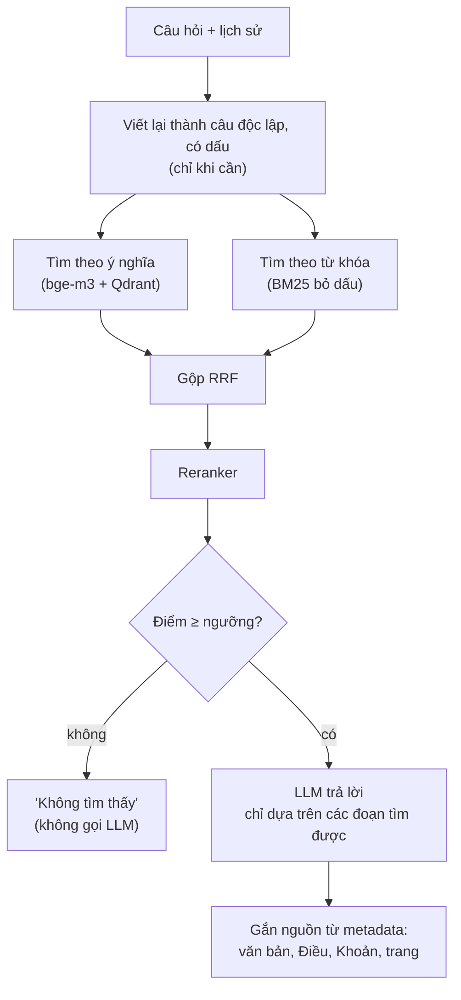

# RAG Chatbot – Hỏi đáp văn bản pháp luật tiếng Việt

Hỏi bằng ngôn ngữ tự nhiên, nhận câu trả lời **kèm trích dẫn đến từng Điều/Khoản và số trang**. Chạy **hoàn toàn trên máy bạn** (Ollama + Qdrant), không cần API trả phí.

## Điểm nổi bật

- **Trích dẫn chính xác:** nguồn lấy từ metadata của đoạn văn bản được truy hồi, không để mô hình tự ghi.
- **Từ chối khi không có thông tin:** câu ngoài phạm vi bị từ chối bằng ngưỡng điểm reranker, không gọi LLM.
- **Hiểu cấu trúc luật:** chia theo Chương / Mục / Điều / Khoản / Phụ lục, bảng thành đoạn riêng.
- **Truy hồi kết hợp:** dense (bge-m3) + BM25 bỏ dấu, gộp RRF, rồi reranker (bge-reranker-v2-m3).
- **Hỏi tiếp và gõ không dấu:** câu nối tiếp, câu không dấu được viết lại thành câu độc lập, có dấu.
- **Cập nhật chỉ mục từng file** (Qdrant), có tracing (OpenTelemetry/Jaeger) và metrics (Prometheus).
- **Ba cách dùng:** giao diện web (trả lời hiện dần), dòng lệnh, REST API.


Phương pháp, bảng đầy đủ và giới hạn: [docs/chi-tiet.md](docs/chi-tiet.md).

## Cách hoạt động



Công nghệ: Python, LangChain, FastAPI, Ollama (`qwen2.5:7b-instruct`), `BAAI/bge-m3`, Qdrant (hoặc FAISS), pdfplumber, Docker, GitHub Actions, pytest (hơn 300 bài, không cần tải mô hình), ruff.

## Bắt đầu nhanh

**Chuẩn bị:** đặt các PDF văn bản pháp luật (phải có lớp chữ, không phải ảnh scan) vào `data/corpus/` và ghi nguồn vào [data/SOURCES.md](data/SOURCES.md). PDF không nằm trong repo; hướng dẫn ở [data/corpus/README.md](data/corpus/README.md).

**Docker** (cần ~10 GB tải mô hình lần đầu):

```bash
docker compose up -d --build
docker compose exec ollama ollama pull qwen2.5:7b-instruct   # chỉ lần đầu
```

Mở http://localhost:8000. Lần đầu dựng chỉ mục mất vài chục phút trên CPU; có GPU NVIDIA thì thêm `-f docker-compose.gpu.yml`.

**Chạy trực tiếp** (Python 3.10 + [Ollama](https://ollama.com)):

```bash
python -m venv .venv && source .venv/bin/activate
pip install -r requirements.txt
ollama pull qwen2.5:7b-instruct

python chatbot.py                                   # dòng lệnh
uvicorn ragbot.api:app --host 0.0.0.0 --port 8000   # giao diện web + API
```

## API

| Đường dẫn | Mô tả |
|---|---|
| `POST /chat` | Trả lời đầy đủ: `{text, refused, question, sources[]}` |
| `POST /chat/stream` | Trả lời hiện dần (SSE) |
| `GET /health`, `GET /metrics` | Trạng thái, số liệu Prometheus |

```bash
curl -X POST localhost:8000/chat -H 'content-type: application/json' \
  -d '{"question": "Nghỉ ốm cần báo trước mấy giờ?", "history": []}'
```

Đặt `RAG_API_KEY` để yêu cầu header `X-API-Key`. Cấu hình qua biến môi trường tiền tố `RAG_` hoặc file `.env` (xem [.env.example](.env.example)).

## Kiểm thử

```bash
pip install -r requirements-dev.txt
pytest -q && ruff check . && ruff format --check .
```

## Hạn chế

- Mô hình 7B có thể trả lời sai dù đã có đúng điều khoản; luôn đối chiếu với nguồn trích dẫn.
- Chưa đo độ chính xác câu trả lời trên bộ pháp luật; ngưỡng từ chối mặc định chưa được hiệu chỉnh lại.
- Chưa phân biệt văn bản còn hiệu lực hay đã bị thay thế.
- Viết lại câu không dấu đôi khi làm sai nghĩa (tắt bằng `RAG_REWRITE_QUERIES=false`).
- PDF dạng ảnh scan chưa được hỗ trợ; chưa có đăng nhập theo người dùng.

Danh sách đầy đủ, hướng phát triển và cách chạy lại các phép đo: [docs/chi-tiet.md](docs/chi-tiet.md).

---

@author: Ngoc Luong <ngocluongg0101@gmail.com>
